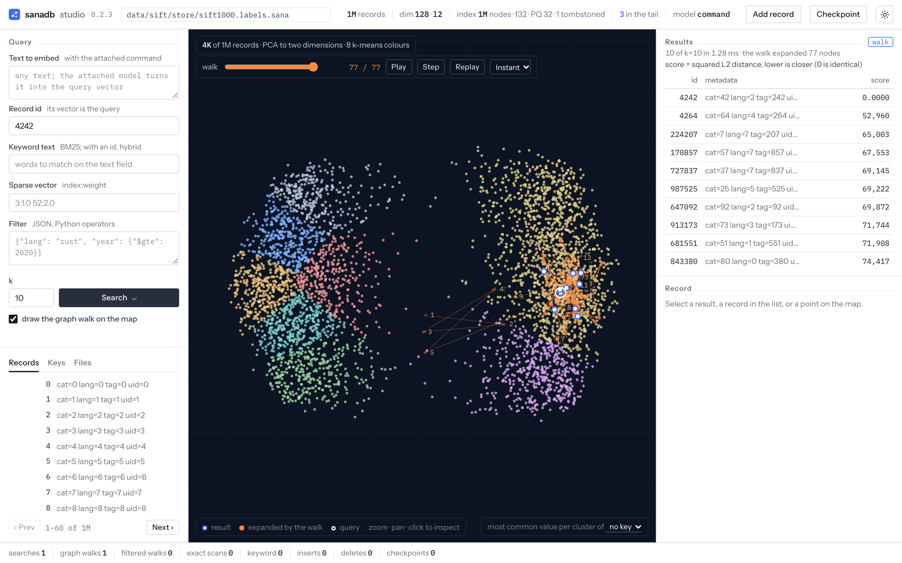

# sanadb

For people who embed search in an application, an agent or a service and
do not want to run a vector server: an embedded vector store in Rust,
with Python bindings. A write-ahead log,
a memory-mapped graph index that keeps working when the data is larger
than RAM, typed metadata with filter-aware search, keyword and sparse
search beside the vectors. One dependency, a few files, no server.

[](https://github.com/RohithOrg/sanadb/actions/workflows/ci.yml)
[](https://crates.io/crates/sanadb)
[](https://pypi.org/project/sanadb/)
[](https://rohithorg.github.io/sanadb/)

```bash
cargo add sanadb      # Rust
pip install sanadb    # Python: wheels for Linux (glibc, musl), macOS, Windows
pip install "sanadb[studio]"   # plus the studio binary on your PATH
```

## What it is

The SQLite of vector search is the goal: open a file, insert vectors with
metadata, search, and get back exactly what you wrote, through crashes,
from any number of reader processes, without a server to run.

- **Durable.** Every write goes to a CRC-framed log; a checkpoint builds
  the index into a new file and swaps it in atomically. Crash, disk-full,
  failed fsync and failed rename are tested, not assumed.
- **Disk-first.** The index is memory-mapped and read in place. A 5M-vector
  index of 3.5 GB answers cold queries in about 3 ms on a laptop; RAM holds
  32 bytes per vector, not the index.
- **Filters that stay correct.** Metadata is typed and stored as columns
  in the index. A rare filter is answered by reading every match (recall
  1.0); a common one steers the graph walk.
- **More than vectors.** BM25 keyword search over a text field, learned
  sparse vectors, and hybrid fusion of either with the dense result.
- **Embedded.** Rust crate and Python package, `Send + Sync`, GIL released
  on the hot paths, readers in other processes follow the writer live.

## Quick start

Rust:

```rust
use sanadb::{Db, Filter, Options, Metric};
use std::collections::HashMap;

let db = Db::open("vectors.sana", Options::new(768).metric(Metric::Cosine))?;
db.insert(1, &embedding, HashMap::from([("doc".into(), "intro.md".into()), ("year".into(), 2024i64.into())]))?;
let hits = db.search(&query, 10)?;
let hits = db.search_where(&query, 10, &Filter::and([Filter::prefix("doc", "intro"), Filter::ge("year", 2020i64)]))?;
db.checkpoint()?; // build the graph index, compact the log
```

Python:

```python
import numpy as np, sanadb

db = sanadb.Db("vectors.sana", dim=768, metric="cosine", text_field="body")
db.insert_many(ids, np.asarray(vectors, dtype=np.float32), metas)
hits = db.search(query, k=10, filter={"year": {"$gte": 2020}, "lang": {"$in": ["en", "de"]}})
hits = db.search(query, k=10, text="tokio select cancellation")   # hybrid: vector + BM25
db.checkpoint()
```

With your own embedding model, the same in three lines:

```python
from sentence_transformers import SentenceTransformer
model = SentenceTransformer("all-MiniLM-L6-v2")
db = sanadb.Db("docs.sana", dim=384, metric="cosine", text_field="body",
               embedding_function=lambda t: model.encode(t, normalize_embeddings=True))
db.add(["The borrow checker rejects aliasing", "asyncio runs coroutines on one thread"], metas=[{"lang": "rust"}, {"lang": "python"}])
db.query(["how do I stop two parts mutating the same thing"], k=3)
```

Scores are distances, lower is closer. The documentation is split by
language so you read one at a time: [Python](docs/python/getting-started.md)
(getting started, [API](docs/python/api.md), [examples](docs/python/examples.md),
[recipes](docs/python/recipes.md)) and [Rust](docs/rust/getting-started.md)
(getting started, [API map](docs/rust/api.md) with the full reference on
[docs.rs](https://docs.rs/sanadb), [examples](docs/rust/examples.md),
[recipes](docs/rust/recipes.md)). Everything below the API, the studio,
the internals, operations, benchmarks and the file format, is shared.

## What it does

| | |
|---|---|
| Metrics | L2, dot product, cosine |
| Index | Vamana graph (DiskANN layout), memory-mapped, product quantization in RAM, optional int8 storage at half the file size |
| Writes | insert, overwrite, delete, atomic batches; a write-ahead log replayed on open; `sync()` for power-loss safety |
| Metadata | typed values (`Str`, `Int`, `Float`, `Bool`, `Sparse`) stored as columns in the index |
| Filters | `Eq`, `Ne`, `In`, `Lt`/`Le`/`Gt`/`Ge`, `Prefix`, `Contains`, `Exists`, `And`/`Or`/`Not`, or any closure; exact scan or filter-steered walk chosen per query |
| Text | BM25 over an inverted index on one text field; `Contains` on tag sets answers from it |
| Sparse | SPLADE-style `(index, weight)` vectors, dot-product search over inverted lists |
| Hybrid | reciprocal rank fusion of the dense result with the keyword or sparse result |
| Processes | one writer, any number of read-only handles in any process, following the writer's writes and checkpoints |
| Embeddings | bring your model: an `Embedder` trait in Rust, `embedding_function` with `add()` and `query()` in Python, an OpenAI-compatible endpoint or command in studio |
| Operations | consistent `backup()`, operation counters in `stats()`, optional `tracing` events |
| Format | frozen for 0.x and specified byte for byte; stores from every published version open and are tested |

## Numbers

Measured on one laptop (Apple Silicon, 16 GB), single query thread, with
the examples in this repository. The full tables, method and caveats are
in [docs/benchmarks.md](docs/benchmarks.md).

- **SIFT1M, warm:** recall@10 0.966 at 146 µs per query (beam 64), 0.995 at
  405 µs (beam 256); build 75 s.
- **ann-benchmarks, their harness:** ahead of hnswlib and usearch at every
  recall on SIFT and from 0.81 up on GloVe, trading places with faiss HNSW,
  while holding 32 bytes per vector in RAM instead of the whole index.
- **Filtered, SIFT1M with labels:** recall 1.0 at 9 µs to 1.3 ms for
  filters matching 0.01% to 1% of the set; the YFCC filter track at 1M
  gets recall 1.0 where post-filtering gets 0.17 to 0.83.
- **Cold, 5M vectors from SIFT1B:** 2.75 ms mean, 4.2 ms p99 after
  evicting the 3.5 GB index from the page cache.
- **Keyword, BEIR SciFact:** nDCG@10 0.662 against rank_bm25's 0.654 and
  Anserini's published 0.665.

## Studio

`sanadb-studio data/vectors.sana` serves a local page that maps the store,
searches it every way the library can, draws the graph walk of a search
on the map, and edits records. See [docs/studio.md](docs/studio.md).



## Should you use it

Not yet for anything that cannot afford a bug: this is a 0.x release that
nobody has run in production. The design, the tests and the numbers are
real; the track record is not there. If you need something dependable this
quarter, [LanceDB](https://lancedb.com) is the closest embedded, disk-based
alternative. faiss, hnswlib and usearch are in-RAM indexes without a log,
metadata or crash safety; Qdrant, Milvus and Weaviate are servers.

What sanadb does not do, by design: a second writer, streaming
replication, encryption inside the files (use the platform's), GPUs. The
limits that are not by design, and the order they are being worked in, are
in [docs/roadmap.md](docs/roadmap.md).

## Guarantees

- A write that returned `Ok` survives a process crash; after `sync()` or
  with `sync_every_write`, power loss too.
- A checkpoint either completes or leaves the previous files untouched.
- Readers never see a partially written record or index.
- One writer per store (`Error::Locked` otherwise), readers anywhere,
  seeing a prefix of the writer's history. Local filesystems only: the
  lock is an advisory `flock`.
- A newer version opens any older store; an older version opens a newer
  store or refuses with `Error::NeedsNewerVersion`, never misreads.

The detail behind each of these is in [docs/operations.md](docs/operations.md).

## Documentation

- Python: [getting started](docs/python/getting-started.md), [API](docs/python/api.md), [examples](docs/python/examples.md) with output (semantic search with sentence-transformers first), [recipes](docs/python/recipes.md).
- Rust: [getting started](docs/rust/getting-started.md), [API map](docs/rust/api.md), [examples](docs/rust/examples.md) with output (semantic search through an embedding endpoint first), [recipes](docs/rust/recipes.md).
- [How it works](docs/architecture.md): log, graph, PQ, delta, checkpoint,
  filters, concurrency, keyword and sparse search.
- [Operating a store](docs/operations.md): durability, processes, backup,
  compatibility, observability, knobs.
- [Compared with the alternatives](docs/compare.md): sqlite-vec, LanceDB, Chroma, faiss and the servers.
- [Failure modes](docs/failure-modes.md): the lock, a torn log, a newer file, a damaged index, with the library's output for each.
- [Benchmarks](docs/benchmarks.md): every table with method and caveats.
- [File format](docs/FORMAT.md): the byte layout, frozen for 0.x.
- [Studio](docs/studio.md): the local web UI.
- [Status, limits and roadmap](docs/roadmap.md).
- Design notes: [snapshot and tail](docs/design/snapshot-and-tail.md),
  [typed metadata and filtered search](docs/design/typed-metadata-and-filtered-search.md),
  [hybrid search](docs/design/hybrid-search.md).
- [CHANGELOG.md](CHANGELOG.md): every release, every format change.

## Development

```bash
cargo test --release
cargo clippy --all-targets -- -D warnings
cd python && maturin develop --release && pytest tests
scripts/ci-local.sh      # the Linux CI steps in Docker, arm64 and x86-64
scripts/soak.sh 120      # writer + checkpoints + readers in two processes
python/.venv/bin/python scripts/refresh-docs.py   # rerun every example into the docs, regenerate the API page and studio screenshots
```

The suite covers crash recovery, injected I/O failures, randomly damaged
index files, cross-process readers, a model-checked random workload, and
the stores written by every published version (`tests/fixtures/`).
Releases are cut by tagging `vX.Y.Z`; the workflow publishes the crate and
the wheels. Licensed under MIT or Apache-2.0, at your option.
