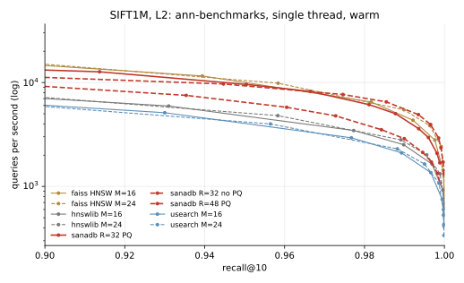
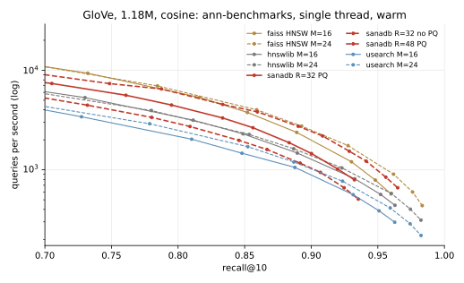
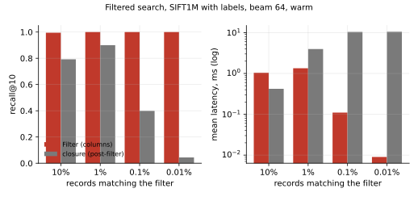
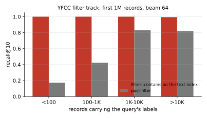
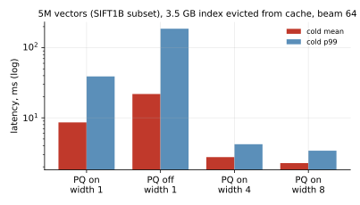

# Benchmarks

Every number here was measured, on one laptop (Apple Silicon, 10 cores,
16 GB, NVMe), single query thread, with the examples and adapters in this
repository. Nothing is quoted from other projects' pages. Absolute numbers
move 20% with what else the machine is doing; comparisons within a table
were taken in one session unless the text says otherwise. There are no x86
numbers yet.

Reproduce: `cargo run --release --example sift1m -- data/sift`,
`examples/filtered.rs`, `examples/yfcc.rs`, `examples/bigann.rs`,
`benchmarks/ann-benchmarks/` (ann-benchmarks adapters and results),
`benchmarks/beir/scifact_bm25.py`, `benchmarks/vectordbbench/`.

## Keyword search, BEIR SciFact

5,183 documents, 300 test queries, `benchmarks/beir/scifact_bm25.py`.
sanadb's `search_text` against the `rank_bm25` reference with the same
tokens, so the comparison is the scoring and the index, not the text
processing. Published Anserini BM25 on SciFact is 0.665 nDCG@10.

| | nDCG@10 | Recall@100 | ms/query |
|---|---|---|---|
| sanadb `search_text` | 0.662 | 0.886 | 1.2 |
| rank_bm25 (Okapi) | 0.654 | 0.876 | 30.6 |

Sparse vectors have no public-dataset number yet; that needs a SPLADE
encoding of a BEIR set and is on the roadmap.

## SIFT1M

1,000,000 vectors, dim 128, L2. The 10,000 published queries and published
ground truth. Index fits in RAM, so this measures CPU, not disk.
`cargo run --release --example sift1m -- data/sift`

| | PQ on | PQ off |
|---|---|---|
| build | 75 s | 71 s |
| index file | 744 MB | 712 MB |
| beam 64: recall@10, mean, p99 | 0.966, 146 µs, 213 µs | 0.971, 225 µs, 319 µs |
| beam 128 | 0.987, 240 µs, 328 µs | 0.989, 371 µs, 490 µs |
| beam 256 | 0.995, 405 µs, 555 µs | 0.996, 623 µs, 832 µs |

10,000 queries per beam, index warm. PQ costs 0.001 to 0.005 recall here
and saves about 35% of the CPU: the walk reads 32 bytes of codes per
candidate instead of a 512-byte vector, and only the final `beam`
candidates are re-ranked exactly.

These are the numbers after profiling the walk (0.1.4), measured back to
back against the 0.1.3 binary on the same index under the same load: beam
64 went from 202 µs to 146 µs, beam 256 from 572 µs to 405 µs, recall
unchanged to four digits. The sampler had shown that sorted-list inserts,
hash-set visited checks and a metadata lookup per visited node were together
about 40% of a warm query, and none of it was distance arithmetic. The
`madvise` prefetch calls are another 15% on a warm index and stay, because
they are what makes a cold query fast; `io_width(1)` turns them off. Absolute numbers move 20% with what
else the machine is doing; the ratio holds. See CHANGELOG.

## ann-benchmarks: hnswlib, faiss HNSW, usearch

Run by the [ann-benchmarks](https://github.com/erikbern/ann-benchmarks) harness
in local mode with the adapters in `benchmarks/ann-benchmarks/`, so the
queries, ground truth, timing and recall computation are theirs. The three
in-RAM HNSW libraries use the harness's own configs at M=16 and M=24,
efConstruction 500 (faiss trimmed to those two groups; usearch has no
upstream adapter, ours is in the same folder and forces f32 vectors so all
four hold the same data). Same laptop, single query thread, k=10, warm,
best of 2 runs. Queries per second at the nearest measured recall, higher is
better; a blank cell means that configuration has no point within 0.01 of
the row's recall. Raw CSVs: `benchmarks/ann-benchmarks/results/`.

### sift-128-euclidean

1,000,000 SIFT vectors, dim 128, L2, their 10,000 queries.

| recall@10 | hnswlib M=16 | hnswlib M=24 | faiss HNSW M=16 | faiss HNSW M=24 | usearch M=16 | usearch M=24 | sanadb R=32 PQ | sanadb R=32 no PQ | sanadb R=48 PQ |
|---|---|---|---|---|---|---|---|---|---|
| ~0.93 | 5,938 (0.931) |  | 11,559 (0.939) |  | 5,119 (0.930) |  |  | 7,517 (0.935) |  |
| ~0.96 |  | 4,797 (0.958) |  | 9,844 (0.958) |  | 3,991 (0.956) | 8,209 (0.966) | 5,775 (0.961) |  |
| ~0.98 | 3,452 (0.977) | 2,808 (0.989) | 6,498 (0.982) | 5,467 (0.990) | 2,936 (0.977) | 2,298 (0.988) | 6,124 (0.981) | 3,514 (0.984) | 7,665 (0.975) |
| ~0.99 | 2,520 (0.990) | 2,808 (0.989) | 4,332 (0.992) | 5,467 (0.990) | 2,102 (0.989) | 2,298 (0.988) | 5,014 (0.988) | 2,883 (0.990) | 4,904 (0.994) |
| ~0.996 | 1,639 (0.997) | 2,011 (0.996) | 2,796 (0.998) | 3,849 (0.996) | 1,357 (0.997) | 1,642 (0.995) | 2,955 (0.996) | 1,716 (0.997) | 3,936 (0.997) |
| ~0.999 | 922 (1.000) | 1,323 (0.999) | 1,425 (1.000) | 2,424 (0.999) | 749 (0.999) | 1,073 (0.999) | 1,689 (0.999) | 1,073 (0.999) | 2,353 (0.999) |
| build | 209 s | 266 s | 132 s | 764 s* | 252 s | 311 s | 122 s | 118 s | 206 s |

### glove-100-angular

1,183,514 GloVe word vectors, dim 100, angular ground truth, their 10,000
queries. The sanadb adapter maps `angular` to `Metric::Cosine`. This dataset
is hard for every graph index; hnswlib reaches 0.98 only at ef = 800. All
four libraries in this table were measured in one session on 16 November
2026 (sanadb with beams up to 1,024); an earlier sanadb-only run on a
fresher machine was about 10% faster at every point, and the in-RAM
libraries did not move between the two runs, which is what a memory-mapped
index under swap pressure looks like. The one-session numbers are the
ones here.

| recall@10 | hnswlib M=16 | hnswlib M=24 | faiss HNSW M=16 | faiss HNSW M=24 | usearch M=16 | usearch M=24 | sanadb R=32 PQ | sanadb R=32 no PQ | sanadb R=48 PQ |
|---|---|---|---|---|---|---|---|---|---|
| ~0.73 | 5,308 (0.730) |  | 9,333 (0.732) |  | 3,409 (0.728) |  |  | 4,456 (0.732) |  |
| ~0.81 | 3,152 (0.811) |  | 5,335 (0.816) |  | 2,029 (0.810) |  |  | 2,722 (0.809) |  |
| ~0.86 |  | 2,264 (0.853) | 3,768 (0.852) | 4,007 (0.859) |  | 1,707 (0.852) | 2,647 (0.856) | 1,600 (0.867) | 3,819 (0.860) |
| ~0.89 | 1,473 (0.890) | 1,628 (0.887) | 2,375 (0.889) | 2,747 (0.893) | 1,057 (0.888) | 1,198 (0.887) | 1,871 (0.883) | 1,167 (0.892) | 2,739 (0.890) |
| ~0.93 | 812 (0.933) | 1,046 (0.923) | 1,203 (0.930) | 1,749 (0.928) | 563 (0.931) | 769 (0.924) | 793 (0.932) | 660 (0.925) | 1,536 (0.929) |
| ~0.95 | 565 (0.952) |  | 788 (0.948) |  | 387 (0.951) | 414 (0.959) |  |  | 843 (0.956) |
| build | 290 s | 418 s | 1021 s | 266 s | 405 s | 562 s | 349 s | 349 s | 697 s |

What the tables say:

- faiss HNSW is the fastest of the four here, about 2x hnswlib at equal
  recall on both datasets. Part of that is SIMD: faiss ships NEON kernels
  for Apple Silicon, while hnswlib's distance code is SSE/AVX intrinsics
  with a scalar fallback. It is not the whole story: sanadb's plain-Rust
  distance loop already compiles to NEON here (18 ns per 128-dim distance,
  hand-written intrinsics were no faster), and its gap to faiss turned out to
  be walk bookkeeping, fixed in 0.1.4. On an x86 server the gap between faiss
  and hnswlib is small in ann-benchmarks' published plots; expect these
  ratios to shift there.
- sanadb is ahead of hnswlib and usearch at every recall on SIFT and from
  recall 0.81 up on GloVe (at 0.73, hnswlib M=16 is 19% ahead of sanadb's
  R=32 without PQ), and trades places with faiss: on SIFT faiss leads
  below recall 0.99 and sanadb R=48 leads above it; on GloVe faiss M=24
  leads at 0.86 and 0.93, the two tie at 0.89, and sanadb R=48 leads at
  0.95 where faiss M=24 has no point. It does this while holding 32 bytes
  of PQ codes per vector in RAM instead of the whole index; the other
  three keep every vector and every edge in memory. PQ costs about 0.005
  recall per beam on these 100-dim vectors (25 subspaces of 4) and is
  worth it for throughput. R=32 reaches 0.933 at beam 1,024: the lower
  degree is not a recall ceiling, it is a longer walk.
- usearch was forced to f32 so that the four libraries hold the same data.
  Its default f16 and i8 modes are faster and are not measured here.
- `*` faiss build times are not comparable between its two groups: the
  upstream adapter calls `omp_set_num_threads(1)` after each build, and in
  the harness's local mode that setting persists into the next group's
  build, so the second group of each dataset built single-threaded (M=24 on
  SIFT, M=16 on GloVe). Builds are multi-threaded for every library
  otherwise; sanadb's are sharded above 1M vectors, which is why the R=48
  GloVe build is slow.
- The GloVe table exists because its first run found a real defect: before
  0.1.3 cosine recall at beam 64 was 0.24, since RobustPrune's alpha test
  misbehaves on negative distances and cosine used negative dot product
  internally. See CHANGELOG.
- The harness's "index size" column is omitted: it measures process memory
  growth during build, which is near zero for a memory-mapped index.

## Filtered search

`examples/filtered.rs`: every record gets four string labels with 10, 100,
1,000 and 10,000 distinct values, so an equality filter on each passes 10%,
1%, 0.1% and 0.01% of the set. 500 published queries, k=10, beam 64, warm;
ground truth is brute force over the records that pass. The column path is
`search_where` with a `Filter`; the closure path is `search_filtered`, which
cannot look inside the filter and widens the beam until `k` pass.

| selectivity | regime | recall@10 | mean | p99 | closure recall@10 | closure mean |
|---|---|---|---|---|---|---|
| 10% | filtered walk | 0.995 | 1.04 ms | 1.8 ms | 0.792 | 0.42 ms |
| 1% | exact scan, 10K matches | 1.000 | 1.34 ms | 1.6 ms | 0.900 | 3.96 ms |
| 0.1% | exact scan | 1.000 | 110 µs | 161 µs | 0.399 | 10.4 ms |
| 0.01% | exact scan | 1.000 | 9 µs | 14 µs | 0.044 | 10.5 ms |

The rare-filter rows are the point: the old path returned 4 of 10 right
answers at 0.1% and almost none at 0.01%, after 10 ms of widened walks; the
posting lists make those the cheapest queries in the table. The scan beats
the walk up to about 20,000 matches warm, which is where the default
`exact_filter_scan` sits; at 10% the scan would take 13 ms and the walk
wins. The 10% walk is 7x an unfiltered query at beam 64 because it needs 64
passing nodes before it can stop; the beam is the knob, measured at 10%:

| beam | recall@10 | mean |
|---|---|---|
| 32 | 0.975 | 0.59 ms |
| 48 | 0.991 | 0.71 ms |
| 64 | 0.995 | 1.1 ms |
| 96 | 0.998 | 1.2 ms |

The post-filter closure path never passes 0.80 at any beam on this filter.

Real label sets: the big-ann-benchmarks filter track (YFCC100M, CLIP
embeddings as uint8, dim 192, 8.8 labels per record, queries asking for one
or two labels). `examples/yfcc.rs` on the first 1,000,000 records, 500
queries, ground truth by brute force over the records carrying the query's
labels; the labels are a space-separated string in the text field and the
query is `Filter::contains` terms and-ed together, answered from the
inverted index. Beam 64, warm, same machine:

| matching records | queries | recall@10 | mean | post-filter recall@10 | post-filter mean |
|---|---|---|---|---|---|
| under 100 | 119 | 1.000 | 0.6 ms | 0.173 | 20.1 ms |
| 100 to 1,000 | 131 | 1.000 | 2.0 ms | 0.422 | 18.7 ms |
| 1,000 to 10,000 | 147 | 1.000 | 11.4 ms | 0.829 | 15.5 ms |
| over 10,000 | 103 | 0.994 | 11.2 ms | 0.818 | 1.1 ms |

The first three rows are the exact-scan regime; the last mixes scan and
filtered walk. The scan's cost is the random reads of the matching
records' blocks (768 bytes each here), which is why the 1,000 to 10,000 row
is slower than the walk would be at that selectivity on a warm index; the
`exact_filter_scan` threshold was tuned on 128-dim SIFT and should be lower
for wider vectors. The full 10M set is not run here: its ground truth is
published, but building it takes an hour on this laptop.

## Cold cache, 5M vectors from SIFT1B

First 5,000,000 vectors of big-ann-benchmarks "bigann" (uint8, dim 128, L2),
the first 1000 public queries, ground truth by brute force. The 3.5 GB index
was evicted with `sudo purge` before each cold pass; the warm pass repeats the
same queries. Beam 64. `examples/bigann.rs` has the exact steps.

| | PQ on, width 1 | PQ off, width 1 | PQ on, width 4 | PQ on, width 8 |
|---|---|---|---|---|
| recall@10 | 0.927 | 0.937 | 0.932 | 0.937 |
| cold mean | 8.6 ms | 21.9 ms | 2.75 ms | 2.26 ms |
| cold p50 | 5.6 ms | 4.5 ms | 2.7 ms | 2.2 ms |
| cold p99 | 39 ms | 187 ms | 4.2 ms | 3.4 ms |
| warm mean | 270 µs | 289 µs | 323 µs | 366 µs |

Checked again for 0.1.4 with the walk rewrite, old and new binary each
after a `purge`, on a busier machine (Docker running): cold mean 3.23 ms
before and 3.20 ms after at width 4, warm 258 µs and 227 µs. The rewrite
does not touch the cold path; the gap to the 2.75 ms above is the machine.

Reading this table: PQ matters in the tail, where the walk without it reads
every neighbour's block from disk. Beam width matters everywhere cold, because
it turns a chain of dependent page faults into batches; width 4 is the default
and costs 20% warm CPU. Cold is still about 8x warm. The rest is the few
rounds of dependent reads a 64-beam walk cannot avoid without speculative
prefetch or an explicit block cache.

## Build memory

Same 5M set, `examples/bigann.rs build`, which streams the 5M inserts through
the normal write path with auto-checkpoint on. Peak resident memory of the
whole process from `/usr/bin/time -l`.

| | 0.1.1, single shard | 0.1.1, 5 shards of 1M | 0.1.3, 5 shards of 1M |
|---|---|---|---|
| insert 5M (with auto-checkpoints) | | | 1114 s |
| final checkpoint | 731 s | 1396 s | 856 s |
| max RSS | about 7 GB (estimated, not measured) | 4.47 GB | 5.13 GB |
| peak anonymous memory | | not recorded | 3.58 GB |
| recall@10, beam 64 | 0.932 | 0.934 | 0.936 |

Sharding halves the build's anonymous memory at the cost of inserting every
vector into two shard graphs. Recall does not move.

Reading the 0.1.3 column: the delta no longer holds vectors in RAM (it reads
them from the mapped log), so the 2.6 GB bulk-load share of the old peak is
gone and the anonymous footprint is 3.58 GB (macOS "peak memory footprint").
Max RSS went up, not down, because RSS also counts resident pages of
memory-mapped files, and this build maps the 2.4 GB vector snapshot and the
index it is writing; those pages are reclaimable and are not what limits the
machine. The final checkpoint is 39% faster than the 0.1.1 sharded build.
The insert row is the realistic streaming path: the geometric auto-checkpoint
rule built intermediate graphs at 250K, 500K, 1M, 2M and 4M records along the
way; a bulk load that sets `auto_checkpoint_delta(0)` skips those.

## Synthetic

Uniform random vectors are the easiest case for approximate search and are
kept only as a regression check: `cargo bench --bench search`. At 100K x 128
the exact scan takes 3.8 ms and the graph 140 µs.
