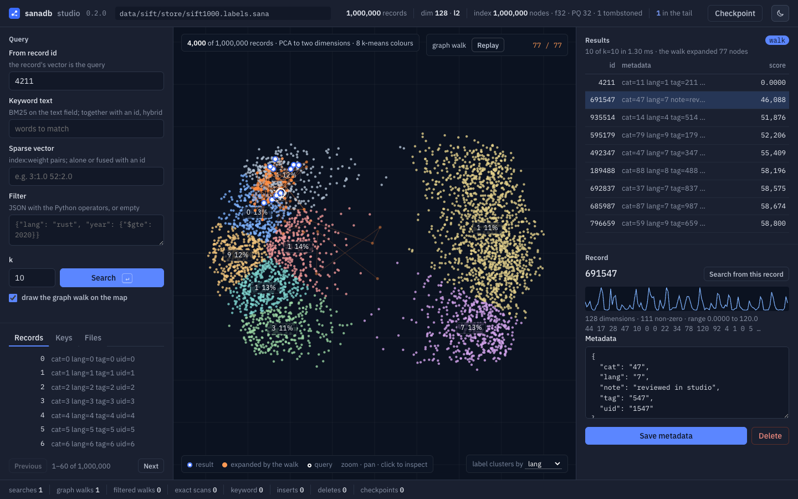

# sanadb studio

A local web page for one store: see what is in it, search it every way
the library can, watch the graph walk of a search on a map of the
vectors, and edit or delete records. One binary, no build step, nothing
leaves the machine.


The chrome follows the system's light or dark setting; the toggle at the
top right overrides it and is remembered.



```bash
cargo install --path studio          # from a checkout, or
cargo run --release -p sanadb-studio -- data/vectors.sana
# sanadb studio 0.2.0: data/vectors.sana (1000000 records, dim 128, L2) at http://127.0.0.1:7070/
```

`sanadb-studio <store.sana> [--port 7070] [--text-field KEY] [--read-only]`.
The dimension and metric come from the file; pass `--text-field` to enable
keyword and hybrid search on the key the store was built with. Studio
opens the store as its writer; if another process holds it, studio falls
back to read-only and says so in the header.

## What the page shows

- **Header:** the file, record count, dimension, metric, the index
  (nodes, storage, PQ, tombstones), how many records sit in the tail
  since the last checkpoint, and a Checkpoint button.
- **Query:** search from a record id (its vector), by keyword text, by a
  sparse vector typed as `index:weight` pairs, or an id together with
  either of those (hybrid), with an optional JSON filter in the same
  grammar as the Python bindings (`{"lang": "rust", "year": {"$gte":
  2020}}`). With the walk box ticked, an unfiltered search also returns
  the nodes the graph walk expanded, in order.
- **Map:** a sample of up to 4,000 records projected to two dimensions by
  PCA and coloured by k-means. Results are blue, the query is a ring, and
  the walk is drawn in amber in the order it happened; replay it as often
  as you like. Scroll to zoom, drag to pan, click a point to inspect it.
  Searches after the map is built are projected onto the same plane.
  "Label clusters by" writes each cluster's most common value of a
  metadata key at its centroid, with the share of the cluster that holds
  it, which is how you see whether the clusters mean anything.
- **Records, Keys, Files:** the records page by page, every metadata key
  with its type, and the store's files with their sizes, reader levels and
  the index's snapshot id.
- **Results:** id, metadata and score, with the search's mode and time.
- **Record:** the vector (a sparkline and its first values), the metadata
  as editable JSON, Save and Delete. A save writes a new version of the
  record to the log; it reaches the index at the next checkpoint, like
  any write.
- **Footer:** the store's operation counters, live.

## What it is for

Checking that an import produced what you meant, finding why a query
returns what it returns (the walk shows where it went), fixing a record's
metadata without writing code, and showing someone what a graph index
does. It is not an admin console: one store, one machine, no
authentication, bound to `127.0.0.1`.
