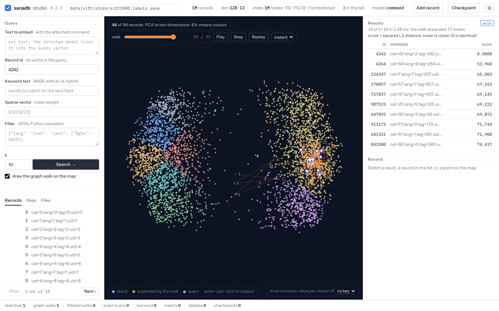
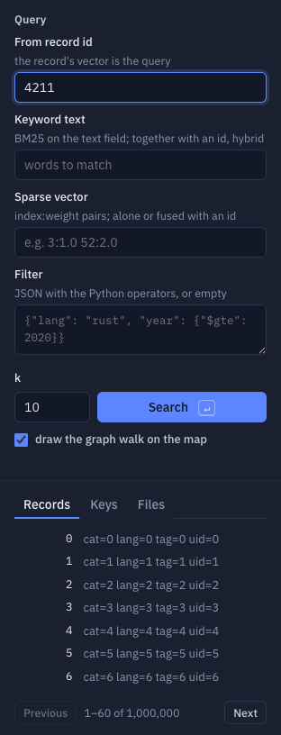
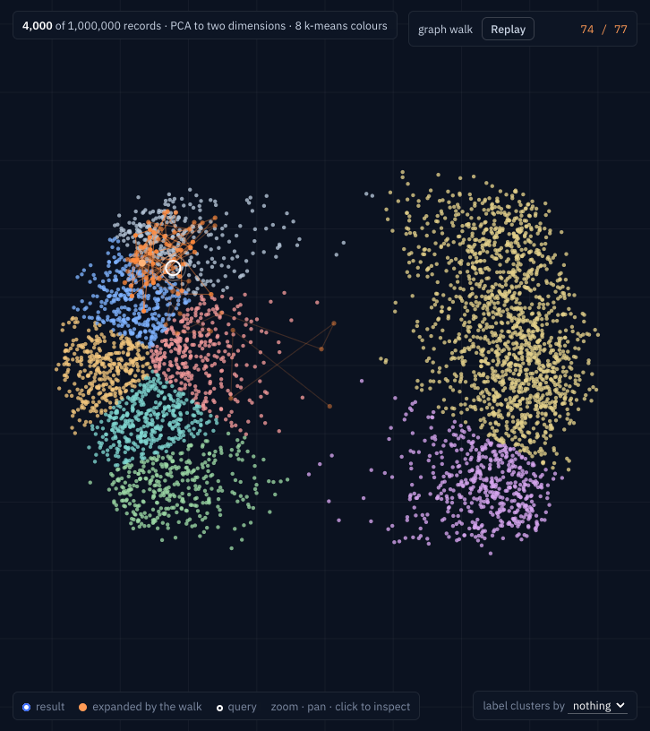
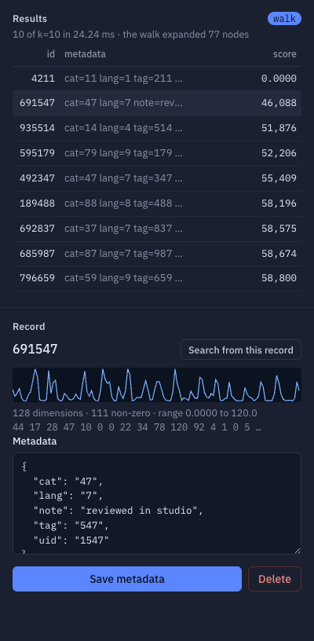
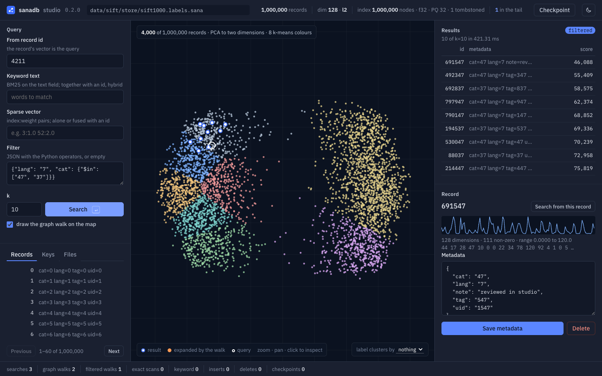
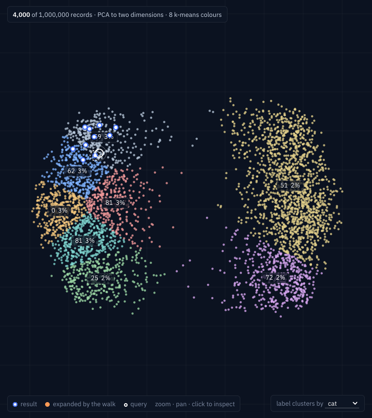
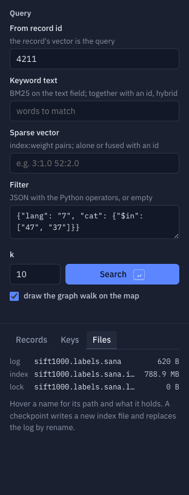

# sanadb studio

A local web page for one store: see what is in it, search it every way
the library can, watch the graph walk of a search on a map of the
vectors, and edit or delete records. One binary, no build step, nothing
leaves the machine.



## Install and open

```bash
cargo install sanadb-studio        # or a prebuilt binary from the GitHub release
sanadb-studio data/vectors.sana
# sanadb studio 0.2.1: data/vectors.sana (1000000 records, dim 128, L2) at http://127.0.0.1:7070/
```

`sanadb-studio <store.sana> [--port 7070] [--text-field KEY] [--read-only]`

The dimension and metric come from the file. Pass `--text-field` with the
key the store was built with to enable keyword and hybrid search. Studio
opens the store as its writer; if another process holds it, studio falls
back to read-only and says so in the header. It binds to `127.0.0.1` and
has no authentication: one store, one machine, one person.

## 1. Read the header


Left to right: the file, how many records are live, the dimension and
metric, the index (nodes, storage, PQ subspaces, records tombstoned since
the last checkpoint), how many records sit in the tail since the last
checkpoint, and the Checkpoint button. A store that has never
checkpointed shows "no index yet": everything still works, searched
exactly over the tail.

The map builds on open: a sample of up to 4,000 records projected to two
dimensions by PCA and coloured by k-means. It takes a few seconds on a
million records and is cached until the next checkpoint.

## 2. Search



- **From record id** uses that record's vector as the query: the way to
  ask "what is near this one".
- **Keyword text** runs BM25 over the text field; with an id as well it
  becomes a hybrid search, fused by reciprocal rank.
- **Sparse vector** takes `index:weight` pairs (`3:1.0 52:2.0`), alone or
  fused with an id.
- **Filter** is JSON in the same grammar as the Python bindings:
  `{"lang": "rust"}`, `{"year": {"$gte": 2020}}`, `{"cat": {"$in":
  ["a", "b"]}}`, `{"$not": {...}}`, `{"$or": [...]}`. Operators: `$eq $ne
  $in $lt $le $gt $ge $prefix $contains $exists`.
- **k** is how many results; Enter in any field searches.
- **Draw the graph walk** asks for the walk trace (unfiltered searches
  from an id only).

The results header names the mode that ran (`nearest`, `filtered`,
`keyword`, `hybrid`, `sparse`, `walk`) and the time the search took
inside the engine.

## 3. Watch the walk



The white ring is the query. The amber trail is every node the graph walk
expanded, in the order it expanded them, older segments dimmer; the
counter at the top right shows how far the replay is and Replay runs it
again. The blue-ringed points are the results. Scroll to zoom, drag to
pan, hover a point for its id, click a point to inspect it. Searches are
projected onto the same plane as the map, so a walk that heads across the
map before settling is a real property of the graph, not of the drawing.

## 4. Inspect and edit a record



Click a result, a record in the list, or a point. The panel shows the
vector (a sparkline, its range and first values) and the metadata as
JSON you can edit. **Save metadata** writes a new version of the record
to the log; it is visible to every reader at once and reaches the index
columns at the next checkpoint, like any write. **Delete** asks first.
**Search from this record** puts its id in the query and runs.

Types are fixed per key: the first value ever written under a key sets
it, and a save that changes a key's type is refused with the reason.

## 5. Filter



With a filter the engine picks the regime per query: few matching
records are read exactly (recall 1.0, microseconds), many steer the
walk. The footer's `exact scans` and `filtered walks` counters tell you
which one ran.

## 6. Label the clusters



"Label clusters by" at the bottom right writes each cluster's most common
value of a key at its centroid, with the share of the cluster that holds
it. A cluster where one value reaches 80% means something; eight clusters
at 11 to 14% each, as on this synthetic set, mean the key is independent
of the vectors. That is the question this control exists to answer.

## 7. Files, keys, records



The left column's tabs: **Records** pages through every live id with its
metadata; **Keys** lists each metadata key with its type; **Files** shows
the log, the index and the lock with their sizes, hover a name for its
path, reader level and the index's snapshot id. The footer counts the
store's operations since studio opened it.

## Checkpoint

The Checkpoint button builds the graph index over every record and
compacts the log, on all cores, without blocking readers. The header's
tail count drops to zero, the index node count rises, and the map is
rebuilt. Run it after a bulk edit or import.

## Light and dark

The chrome follows the system setting; the toggle at the top right
overrides it and is remembered in the browser. The map viewport is dark
in both.


## What it is not

Not an admin console and not multi-store: one file, one process, no
users. Inserting new records from the page is not there yet (it needs a
vector, and the page has no embedding model); import from a file is on
the roadmap.
